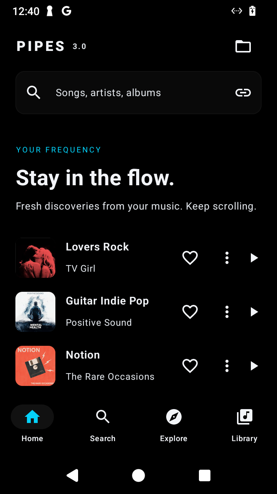

<p align="center">
  
</p>

<p align="center">
  <a href="https://github.com/brimzy/pipes/releases/latest"></a>
  
  
</p>

<p align="center">
  <strong>A music player for Android with song radio, continuous discovery, and local audio.</strong><br />
  Black and charcoal surfaces. Cyan accents. Your library, queue, and playback in one place.
</p>

<p align="center">
  <a href="https://github.com/brimzy/pipes/releases/latest/download/app-release.apk"><strong>Download APK</strong></a>
  &nbsp; · &nbsp;
  <a href="https://github.com/brimzy/pipes/releases">All releases</a>
  &nbsp; · &nbsp;
  <a href="#build">Build from source</a>
  &nbsp; · &nbsp;
  <a href="https://github.com/brimzy/pipes/issues">Report an issue</a>
</p>

---

## Get started

1. Download **app-release.apk** from the [latest release](https://github.com/brimzy/pipes/releases/latest).
2. Open the APK and allow installation from your browser or file manager if Android asks.
3. Open Pipes. Search for music, paste a Spotify link, or use the folder button to play a local file.

Requires **Android 8.0 or newer**. Install new releases over the existing app to keep your library and settings.

## A look inside

<p align="center">
  
  &nbsp;&nbsp;&nbsp;
  
</p>

## What it does

| Feature | How it works |
| :--- | :--- |
| **Discover** | Keep scrolling for music related to the playing song and your liked artists. |
| **Song radio** | Start radio from a recording without resetting its playback position. |
| **Playback** | Background audio, shuffle, repeat, a live queue, and a waveform that lights up as you seek. |
| **Your library** | Save liked songs, create playlists, and revisit recent searches. |
| **Spotify links** | Find a song or import a public playlist without signing in to Spotify. |
| **Local audio** | Open files including FLAC and WAV in their original format. |
| **Offline downloads** | Save direct HTTPS audio-file links and organize them into categories. |

Use a song’s **⋮ → Add to queue** action to queue it without interrupting playback.

## Updates & settings

Open the **gear icon** to find Settings.

- **App updates:** Pipes checks GitHub for newer releases. Choose **Download** to get an update, then confirm installation through Android.
- **Later:** Dismiss an update to postpone reminders for **five days**, including across restarts.
- **Check for updates:** Check manually at any time, even during the reminder pause.
- **Automatic checks:** Turn them on or off. Automatic prompts appear only when an update is available.
- **Recommendation region:** Follow the current song automatically or choose a country for new recommendations.

Updates preserve your saved data. APKs are checked against the release checksum and installed signing key before installation.

## Audio & sources

Online playback uses YouTube Music recordings. Spotify links provide song and playlist metadata; playable matches come from YouTube Music.

YouTube audio is compressed. Local FLAC and WAV files retain their original format. The offline downloader accepts **direct audio-file URLs**, rather than Spotify or YouTube watch links.

Spotify playlist import depends on an undocumented guest endpoint. Source changes can affect importing or playback. The waveform is a visual seek control, not measured audio amplitude.

## Build

**Requirements:** JDK 17+, Gradle 8.14.4, Android SDK 36, and Android Build Tools 36.0.0. Configure `ANDROID_HOME` or `sdk.dir` in `local.properties` for your SDK.

```bash
git clone https://github.com/brimzy/pipes.git
cd pipes
gradle :app:assembleDebug
```

Debug APK: `app/build/outputs/apk/debug/app-debug.apk`

Run the project checks:

```bash
gradle :app:assembleDebug :app:testDebugUnitTest :app:lintDebug
```

<details>
<summary><strong>Optional live source tests</strong></summary>

These tests make network requests and depend on the upstream services being available.

```bash
PIPES_LIVE_SOURCE_TEST=1 gradle :app:testDebugUnitTest
PIPES_LIVE_SPOTIFY_TEST=1 gradle :app:testDebugUnitTest
PIPES_LIVE_DISCOGRAPHY_TEST=1 gradle :app:testDebugUnitTest
```

</details>

Signed releases are built and published by [GitHub Actions](https://github.com/brimzy/pipes/actions/workflows/release.yml) after the build, unit tests, and lint pass. Debug and release APKs use different signing keys and cannot replace each other directly.

---

Found a bug? [Open an issue](https://github.com/brimzy/pipes/issues) with your Android version, Pipes version, and steps to reproduce it.
