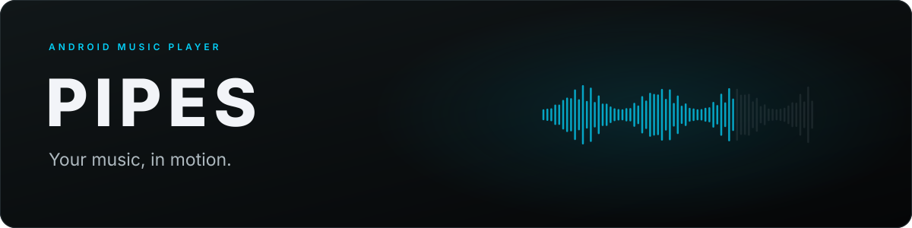
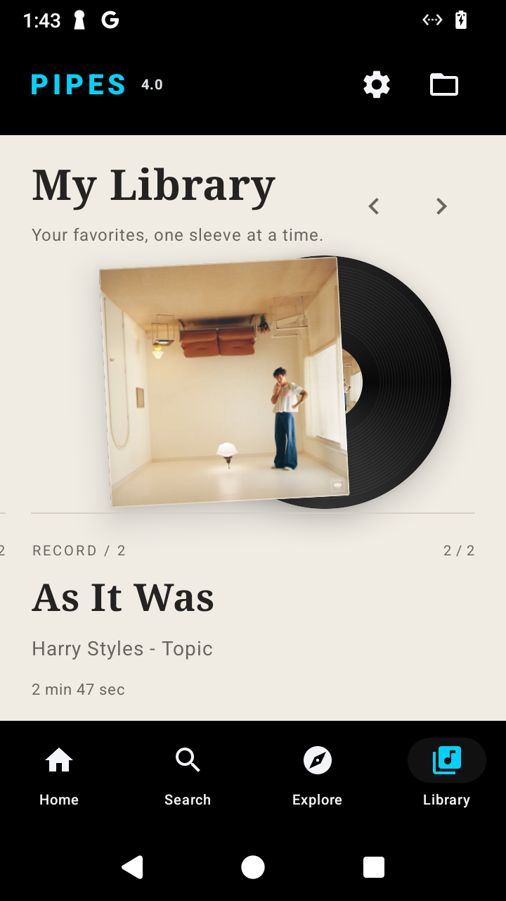
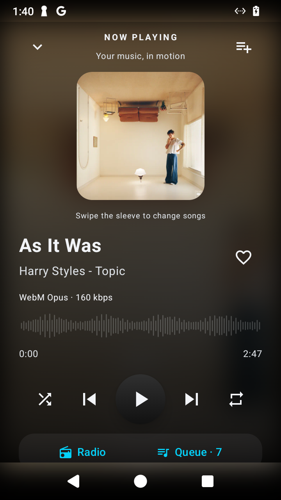

<p align="center">
  
</p>

<p align="center">
  <a href="https://github.com/brimzy/pipes/releases/latest"></a>
  
  
</p>

<p align="center">
  <strong>Pipes 5.1 — a music player with artwork discovery, song radio, and local audio.</strong><br />
  Monochrome charcoal surfaces. An artwork atmosphere that follows your music. Neutral text and small color accents for active controls. Your library, queue, and playback in one place.
</p>

<p align="center">
  <a href="https://github.com/brimzy/pipes/releases/latest/download/app-release.apk"><strong>Download APK</strong></a>
  &nbsp; · &nbsp;
  <a href="https://github.com/brimzy/pipes/releases">All releases</a>
  &nbsp; · &nbsp;
  <a href="#build">Build from source</a>
  &nbsp; · &nbsp;
  <a href="https://github.com/brimzy/pipes/issues">Report an issue</a>
</p>

---

## Get started

1. Download **app-release.apk** from the [latest release](https://github.com/brimzy/pipes/releases/latest).
2. Open the APK and allow installation from your browser or file manager if Android asks.
3. Open Pipes. Search for music, paste a YouTube or Spotify link, or use the folder button to play a local file.

**Upgrading from 4.x:** download the first 5.0 APK directly from Releases. The 4.x updater does not recognize 5.x release tags. Install over the existing official app to preserve your library; 5.0 recognizes future 5.x updates.

Requires **Android 8.0 or newer**. Install new releases over the existing app to keep your library and settings.

## A look inside

<p align="center">
  
  &nbsp;&nbsp;&nbsp;
  
</p>

## What it does

| Feature | How it works |
| :--- | :--- |
| **Android Auto** | Browse saved likes, playlists, completed downloads, and search your saved library from a compatible car host. |
| **Explore** | Browse moods and genres with playable artwork previews, session caching, refresh and retry. |
| **Discover** | Keep scrolling for music related to the playing song and your liked artists. |
| **Song radio** | Start radio from a recording without resetting its playback position. |
| **Playback** | Background audio, shuffle, repeat, a live queue, and a waveform that lights up as you seek. |
| **Your library** | Save liked songs, create and edit named playlists or custom albums, bulk-add music, and revisit recent searches. |
| **Search links** | Paste YouTube videos, playlists and radio mixes, or Spotify songs and public playlists directly into search. |
| **Local audio** | Open files including FLAC and WAV in their original format. |
| **Offline downloads** | Download the playing song, direct HTTPS audio files, or accessible public Instagram videos; organize downloads into categories. |

Swipe a song right to add it to the queue or left to remove an upcoming entry. Cross the threshold and release to commit; hold a song to select it, then tap more songs and choose **Add to…** to save them together. Use the three-dot menu for Play next, radio, playlist, like, download, and queue actions. Play next moves an upcoming song forward or inserts a new one immediately after the current song, including during shuffle. Screen readers expose the same actions.

## Design & gestures

Pipes uses a charcoal canvas and translucent surfaces over a persistent artwork backdrop with neutral typography, a restrained cyan accent, Libron regular and bold typography, and a four-point spacing grid. Home combines a featured recording with an artwork grid that refreshes around the selected song. Radio keeps source relevance within a bounded selection window while varying artists and excluding duplicate recordings. It reads additional source pages and builds up to 30 upcoming songs per batch, refilling as the queue runs down.

A compact floating navigation dock expands the active destination, with custom line icons and a single moving cyan marker. Its translucent ink surface shares the player’s subtle edge lighting and soft shadows. Spring feedback makes selection and presses responsive.

Artwork has a muted two-pixel rim and consistent shadows. Home and Explore share the same card layout and spacing. Library opens directly into collection actions, downloads, playlists and liked songs, without duplicate featured recordings. The player presents the original artwork. Its waveform previews time immediately while dragging, grows and glows around the preview point, and commits the seek on release.

Playback opens in the full player, with the original waveform seek design. Swipe the mini-player song row left for next or right for previous. Home features a swipeable artwork carousel with live audio motion for the current song. Minimize the full player to keep a compact player with a slim seek bar and elapsed/total time above navigation. The close button stops playback, clears the queue, and dismisses the player; the down arrow minimizes while music continues. Hold a song row or discovery card to select songs in bulk; the three-dot menu opens song actions. Use **+** in the player to choose or create a playlist or custom album. Open a collection to rename it, remove songs, delete it, or add all of its songs to another collection. Artist releases have **Add whole release** for saving an album at once. Kirby inhales cover artwork after successful additions. Open a playlist or custom album and choose **Choose artwork** to use your own image or animated GIF. Covers appear in Library and the collection picker, stay saved when the original file is moved, and can be changed or reset with **Use default artwork**.

## Updates & settings

Open the **gear icon** to find Settings.

- **App updates:** Pipes checks GitHub for newer releases. Choose **Download** to get an update, then confirm installation through Android.
- **Later:** Dismiss an update to postpone reminders for **five days**, including across restarts.
- **Check for updates:** Check manually at any time, even during the reminder pause.
- **Automatic checks:** Turn them on or off. Automatic prompts appear only when an update is available.
- **Recommendation region:** Follow the current song automatically or choose a country for new recommendations.

Updates preserve your saved data. APKs are checked against the release checksum and installed signing key before installation.

## Audio & sources

Online playback uses YouTube Music recordings. Spotify links provide song and playlist metadata; playable matches come from YouTube Music.

YouTube audio is compressed. Local FLAC and WAV files retain their original format. The player’s **Download** button saves the best available progressive audio for the playing song into a chosen offline category. It recognizes local files and already queued or completed downloads. The link downloader also accepts **direct HTTPS audio-file URLs** and **public Instagram Reel/video post links**. Instagram videos are saved as MP4; Pipes plays their audio. It does not extract lossless audio from video, download Spotify streams, or accept YouTube watch links in the manual link form. To download a YouTube Music recording, use the player or song-menu Download action; availability depends on the source.

Spotify playlist import depends on an undocumented guest endpoint. Source changes can affect importing or playback. The main waveform keeps its original silhouette while bass, midrange and treble frequencies animate its bars. Stereo FFT analysis provides fast attacks and smooth decay; pause, silence and scrubbing restore the exact original seek pattern.

## Instagram downloads

Open **Download media**, paste an `https://www.instagram.com/reel/.../` or `/p/.../` link, optionally enter a title and category, then select **Download**. Only save media you own or have permission to download.

Resolution happens directly on your device against Instagram. Pipes strips tracking parameters from the post URL and accepts extracted media only from Instagram/Meta CDN hosts over HTTPS. It does not request your password, import cookies, or use third-party downloader services. Private posts, Stories, photos, and carousels are unsupported. Public posts also fail if Instagram requires login, blocks requests, or omits video metadata; this is best-effort support, not guaranteed access. Downloads remain compressed MP4 video files, including their video data.

## Privacy & security

These protections describe the **Android 5.0 app**; the separate iOS preview has a different implementation.

- Library, likes, playlists, search history, settings, and download records are stored on your device. Pipes includes no analytics or crash-reporting SDK and operates no collection server.
- Android backup and device-transfer rules exclude app data. Uninstalling or clearing app storage removes local settings and library data. Device manufacturers can differ in how they implement transfer restrictions.
- Downloads use app-specific storage, without broad storage permissions. Android's system download service manages transfers and may retain download metadata and display titles in notifications. These files are not encrypted by Pipes.
- Unrecognized media controllers are rejected. Controllers trusted by Android receive limited playback controls; validated car hosts can browse and play saved library entries; only the app's own UID receives Pipes-specific queue/radio commands and arbitrary queue insertion. Android may trust notification listeners you explicitly enable, which can see media metadata.
- Cleartext network traffic is disabled and playback cannot follow HTTPS-to-HTTP redirects. Direct download inputs reject embedded credentials, custom ports, literal IP addresses, and localhost names. This is input hardening, not a network firewall: direct-link hosts and redirects are still handled by Android's download service. Use sources you trust.
- Updates still require the official repository asset URL, release checksum, matching app identity/signing certificate, and Android installation confirmation. Release signing secrets stay outside the source tree.

Online features necessarily send requests to their providers: searches, playback, recommendations and artwork contact YouTube/Google; Spotify imports contact Spotify; Instagram downloads contact Instagram/Meta; update checks contact GitHub; direct downloads contact the chosen host. Those services receive your IP address and request information and apply their own privacy policies. Pipes cannot promise anonymous networking, zero data processing, protection on a rooted/compromised device, or absolute security. Offline files can be played without a network connection.

To report a vulnerability, use the repository's private security reporting feature if available; avoid posting credentials or personal files in public issues.

## Build

**Requirements:** JDK 17+, Gradle 8.14.4, Android SDK 36, and Android Build Tools 36.0.0. Configure `ANDROID_HOME` or `sdk.dir` in `local.properties` for your SDK.

```bash
git clone https://github.com/brimzy/pipes.git
cd pipes
gradle :app:assembleDebug
```

Debug APK: `app/build/outputs/apk/debug/app-debug.apk`

Run the project checks:

```bash
gradle :app:assembleDebug :app:testDebugUnitTest :app:lintDebug
```

<details>
<summary><strong>Optional live source tests</strong></summary>

These tests make network requests and depend on the upstream services being available.

```bash
PIPES_LIVE_SOURCE_TEST=1 gradle :app:testDebugUnitTest
PIPES_LIVE_SPOTIFY_TEST=1 gradle :app:testDebugUnitTest
PIPES_LIVE_DISCOGRAPHY_TEST=1 gradle :app:testDebugUnitTest
```

</details>

Signed releases are built and published by [GitHub Actions](https://github.com/brimzy/pipes/actions/workflows/release.yml) after the build, unit tests, and lint pass. Debug and release APKs use different signing keys and cannot replace each other directly.

---

Found a bug? [Open an issue](https://github.com/brimzy/pipes/issues) with your Android version, Pipes version, and steps to reproduce it.

## iPhone / iPad

A first native SwiftUI version is available under [`ios/`](ios/README.md), for **iOS 17+**. Download `Pipes-iOS.ipa` from an `ios-v3.0.*` entry on the [release page](https://github.com/brimzy/pipes/releases). The IPA requires signing with a sideloading tool or installation from Xcode; it cannot install directly from Safari.

This version includes search, embedded online playback, local audio with background playback, likes, and a queue. See the [iOS guide](ios/README.md) for feature differences and build instructions.
